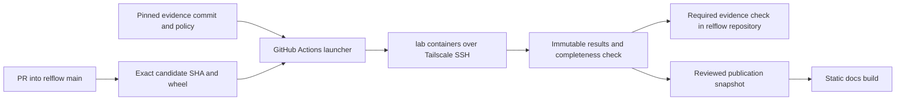

# Evidence repository and pre-merge execution

Status: implementation in progress, October 31, 2026. The evidence repository,
GitHub report releases, and docs snapshot import are implemented. Primary
execution now uses lab over Tailscale; Modal remains an optional backend.

Confirmed decisions: run the full suite before merging; block on execution
errors and agreed behavioral regressions; publish relflow/evidence publicly;
and require no AWS account or S3 setup. The lab backend runs each experiment
inside a bounded, network-disabled Docker container.

The initial regression policy compares each declared experiment/seed against
a fresh run of the PR base in the same environment. Every check that passes on
the base must also pass on the candidate. Existing misses remain reported.
No historical failure is silently exempted, and no thresholds were changed.

The intended outcome is a canonical `relflow/evidence` repository, a docs
section named Evidence, and a required check on pull requests into
`relflow/relflow:main` that waits for evidence execution on lab over Tailscale.

## Implementation evidence

- Public source and extracted history: [relflow/evidence](https://github.com/relflow/evidence).
- First immutable export: [archive-20261031](https://github.com/relflow/evidence/releases/tag/archive-20261031).
- Imported bundle SHA-256: `3fd9398fa13ad52b3362c6be5b71eb4b81fb4b85fc80c58fc4c90bf826871b89`.
- The historical archive is byte-identical, and executable ASTs of all 79
  experiments match the extraction manifest. The evidence tooling has 44
  passing static tests. Its GitHub validation and publication workflows pass.
- Docs static validation has 63 passing tests; all 129 pages render with link,
  anchor, and diagram checks passing. Old Proofs URLs redirect to Evidence.
- Paired two-step lab smoke execution completed without runtime errors. Smoke
  runs correctly fail the required learning gate. Full paired CPU validation
  is in progress on lab against RelFlow main at
  `10c359cf26b54965b56851dc14846eefa2cec3c2`.
- The Modal service-user attempt was blocked by the existing Starter plan;
  no credentials were created or copied to GitHub. Partial Modal validation
  was stopped and retained when primary execution moved to lab.

## Verified starting point

- The docs checkout contains 79 registered experiments. Historical
  interpretations are 58 Passing, 10 Partial, and 11 Limited. Latest full runs
  have 72 `met` and seven `not_met` outcomes. A Limited experiment can meet all
  its checks by demonstrating an information boundary.
- Latest full runs used RelFlow 0.2.1 for 38 experiments, 0.2.2 for 40, and
  0.3.5 for one. They comprise 52 GPU and 27 CPU runs. These are archived
  measurements, not validation of current RelFlow or of Modal execution.
- `proofs/reporting.py` records unmet behavioral checks but exits unsuccessfully
  only on execution errors. `proofs/run.py` propagates subprocess failures.
  Successfully running that command is therefore insufficient as a merge gate.
- `proofs/render.py` reads canonical scripts and `results.yaml`, producing
  ignored pages under `docs/proofs/`. Static builds do not import RelFlow.
  The renderer, checks, tests, Quarto configuration, and reproduction commands
  currently assume both repositories' content lives in this checkout.
- Live GitHub inspection found `relflow/relflow:main` at
  `10c359cf26b54965b56851dc14846eefa2cec3c2`. Its branch protection has no
  required status checks, strict updating is disabled, and administrator
  enforcement is disabled. The effective rules endpoint returned no additional
  rules. Its accelerator workflow runs on a schedule or manual dispatch.
  `relflow/evidence` was not resolvable with the current GitHub account.
- The docs checkout is on `main`, five commits ahead of `origin/main`, with
  existing edits to `AGENTS.md`, `docs/concepts/model-tree.qmd`, and
  `docs/datatypes/branch.qmd`. Extraction must select a reviewed source commit
  and preserve unrelated work. The sibling RelFlow checkout has active edits
  on `stage/0.4.0`; it is not the proposed CI input.

Current sources: [runner](https://github.com/relflow/evidence/blob/main/lab_run.py),
[reporting](https://github.com/relflow/evidence/blob/main/experiments/reporting.py),
[registry and archive](https://github.com/relflow/evidence/blob/main/archive/results.yaml),
[protocol](https://github.com/relflow/evidence/blob/main/SPEC.md),
[publisher](../scripts/render_evidence.py), [static checks](../scripts/check.py), and
[docs workflow](../.github/workflows/docs.yml). The starting-point GitHub observations above predate implementation and must
be refreshed before changing branch protection.

## Ownership after extraction

| Repository | Responsibility |
| --- | --- |
| `relflow/relflow` | Library, ordinary tests, reviewed evidence revision, and the workflow/check that governs merging into `main`. |
| `relflow/evidence` | Canonical experiments, protocol, registry, archived measurements, runtime tests, gate policy, lab runner, optional Modal backend, and publication exporter. |
| `relflow/docs` | Website, Evidence navigation and presentation, shared visual assets, and a committed publication snapshot from a specified evidence revision. |

The docs snapshot contains static page inputs, code downloads, recorded result
downloads, and provenance. It is a publication artifact, not a second editable
experiment source. Store it under `vendor/evidence/`, with its evidence commit,
result selection, schema version, and file digests in `contracts/evidence.json`.
A local preparation script materializes ignored `docs/evidence/` pages.
`make check`, `make check-docs`, `make render`, and `make dev` continue to work
from this checkout alone, without fetching another repository or installing
RelFlow, Torch, Lightning, or Modal.

Snapshot refresh is an explicit, reviewable import. It must show the RelFlow
revision and execution profile behind each selected result. Unmerged candidate
runs remain CI artifacts; publication of a new snapshot is a separate action.
The exporter must carry the required prose, sources, and result data, and
declare its interface to docs-owned Typst assets and styles. Evidence execution
must not depend on a sibling docs checkout.

## Report storage without AWS

- **Every CI run:** upload a bundle containing the manifest, individual JSON
  results, aggregate gate decision, HTML report, and logs as a GitHub Actions
  artifact. Retain passing and failing runs under the configured artifact
  retention policy; these attachments are temporary.
- **Retained baselines and published evidence:** publish complete, versioned
  report bundles as GitHub Release assets in `relflow/evidence`. Enable release
  immutability and include checksums. Upload all assets before publishing the
  release. Preserve the candidate wheel and environment lock for retained
  reproducible runs. Promote selected bundles before CI artifacts expire.
- **Reviewed selections:** keep report schemas, gate policies, and small
  baseline manifests in Git. Each manifest identifies the run, evidence and
  RelFlow revisions, exact release asset, and bundle digest. Baseline changes
  remain reviewable; routine runs do not silently update them.
- **Docs access:** an explicit importer downloads a pinned release bundle from
  GitHub, verifies its digest, and updates `vendor/evidence/` and
  `contracts/evidence.json` in a docs PR. The render step reads that committed
  snapshot. Public releases support public download; private releases require
  appropriate GitHub read access for the importer.

Preserve the existing historical `results.yaml` in Git during extraction. New
runs write independent JSON records within each bundle, preserving every retry
as a separate attempt. GitHub Actions artifacts alone are not the long-term
baseline archive because their configured retention expires. The initial
policy retains selected baseline and publication bundles long term; indefinite
retention of every routine CI run is not part of this proposal.

## Rename and preservation

- Rename the public section, navigation, catalog, generated routes, assets,
  shortcodes, tests, and instructions from Proofs to Evidence. Update all
  internal links together and generate static redirects for the existing
  `proofs.html` and per-experiment URLs, preserving useful anchors.
- Keep existing stable IDs such as `P001`. An identifier is a historical source
  handle; changing the section's name does not require renumbering experiments.
- Extract the canonical sources, protocol, reporting and source tools, runtime
  tests, and result history with their relevant Git history. Include `LICENSE`,
  `NOTICE`, and an extraction manifest recording source repository, exact commit,
  old-to-new paths, and digests. Do history filtering in a separate clone.
- Preserve archived result payloads, recorded paths, measurements, package
  versions, and fingerprints. Translate legacy paths in a reader or explicit
  migration map. Version any new registry or run schema deliberately.
- Keep experimental data generators, seeds, budgets, model capacities,
  optimizers, and numerical gates unchanged during extraction. Import/path or
  API changes can change fingerprints; retain the old records and show their
  original provenance. A migration never constitutes a fresh learning result.

## Execution and merge check

1. Add a small workflow in `relflow/relflow`, triggered by `pull_request` into
   `main` and by `merge_group` if a merge queue is enabled. Run on the PR's
   synthetic merge SHA, or the queue's candidate SHA, and record the head and
   base revisions too. Require an up-to-date branch or a merge queue so a
   changed base cannot reuse an obsolete green result.
2. Check out the evidence suite at a full reviewed commit SHA recorded in the
   library repository. Build a wheel from the exact candidate, record its
   digest, and install that artifact in lab's locked container runtime. Do not install
   a published RelFlow release in place of the candidate. Assert the imported
   package comes from the wheel installation.
3. The launcher waits for lab completion. Run every registered experiment
   using its declared budgets and seed plan, with bounded parallelism across
   experiment/seed pairs. GitHub-hosted Actions joins the tailnet with a short-lived OIDC identity and
   calls a pinned dispatcher over SSH. Every task runs in a separate Docker
   container, with no network, a read-only root, and explicit resource limits.
4. Keep CPU behavioral execution as required by the current protocol. Use a
   separate, pinned CUDA profile for accelerator coverage where justified.
   A switch from CPU to GPU requires fresh comparison; GPU speed alone cannot
   substitute for the declared CPU gate. Measure representative full runs and
   then the whole catalog before changing concurrency or timeouts.
5. Write a distinct result artifact per experiment, seed, profile, and attempt.
   The current `fcntl`-locked shared YAML update is local-process coordination,
   not a distributed result store. Aggregate artifacts in a single collector;
   never have distributed workers overwrite a common `results.yaml`.
6. Record candidate/head/base SHAs, evidence SHA, policy and lock digests, wheel
   digest, source fingerprints, backend run identifiers, image/environment,
   hardware, seeds, budgets, metrics, checks, errors, and timing. Upload raw
   records, logs, and an aggregate report even on failure. Retain accepted
   baselines as versioned GitHub Release bundles beyond short-lived CI artifact
   retention.
7. Expose one stable required check, `Evidence / required`, in the library
   repository. Its final job always evaluates upstream job outcomes and
   artifact completeness. Errors, missing jobs, cancellations, timeouts,
   invalid results, and insufficient seeds must prevent success. Avoid path
   filters or skipped jobs that silently bypass the requirement.

Keeping orchestration and the final check in `relflow/relflow` avoids making a
cross-repository dispatch result responsible for satisfying branch protection.
The evidence repository should also validate changes to its own suite against
a pinned RelFlow baseline. A suite or policy update in the library becomes a
reviewed revision bump; an upstream evidence push cannot silently alter gates.

Use the pinned reusable lab workflow with Tailscale workload identity
federation. Trust must match `relflow/relflow` and the exact reusable workflow
commit. The workflow rejects fork execution and pins a separate tested
implementation. Only public Client ID and lab target variables are needed;
no long-lived CI client secret is stored. Tailnet policy must permit the CI tag
to use noninteractive SSH on lab. Human SSH check approval does not grant
access to ephemeral CI nodes. Missing trust or connectivity fails the gate.

## Agreed behavioral gate policy

Run the full catalog before merging. Execution success and capability success
are separate requirements:

- **Required regression evidence:** calibrated experiments enforce their
  declared held-out metrics, matched controls, and seed aggregation. The
  protocol calls for three paired seeds for mature core claims, including
  baseline and catastrophic-failure checks. Gate changes need explicit review.
- **Boundary evidence:** negative controls and demonstrations of limitations
  enforce their intended checks. Low predictive accuracy can be the expected
  result; the historical label `Limited` is not an expected exception.
- **Exploratory evidence:** run and report measurements, with execution errors
  still blocking. Explicitly register provisional or currently unmet capability
  gates and their rationale; do not blanket-allow the seven archived `not_met`
  outcomes or treat old outcomes as an approved baseline.

Smoke runs validate plumbing and remain marked `smoke`; they cannot satisfy
learning requirements. Numerical gate misses are results, not infrastructure
exceptions. Do not retry with new seeds until a run happens to pass. Fix the
seed plan and threshold policy before judging candidate results.

## Delivery sequence and acceptance

| Change | Acceptance |
| --- | --- |
| 1. Rename the docs section locally | Every old route has a destination; navigation, links, catalog, and visuals agree; static and rendered checks pass. |
| 2. Extract `relflow/evidence` and import its first snapshot | All 79 IDs and archived records survive the manifest audit; evidence runtime tooling works independently; docs build from their own checkout with only docs dependencies. |
| 3. Add lab execution and artifact collection | Paired smoke execution succeeds in isolated containers; the full catalog runs against a known RelFlow commit on lab. |
| 4. Establish and review gate policy | Each experiment has an explicit policy; current-main baseline and required seed panels are measured; outstanding failures are resolved or explicitly classified. |
| 5. Add candidate CI in reporting mode | A real PR tests the exact candidate wheel; an induced behavioral regression, an execution error, a missing result, and cancellation each fail aggregation. |
| 6. Enable required protection | After a successful real check exists, require `Evidence / required`, prevent stale-base acceptance, and apply the chosen bypass policy. Keep existing test requirements. |

The rename and extraction can be adjacent coordinated PRs. Do not remove the
local canonical source until the new repository and verified snapshot exist.
Enable the required gate after baseline calibration and failure-path validation.

Remaining activation work: configure the Tailscale OIDC trust and noninteractive
SSH rule, validate a real library PR end to end, then enable required protection.
Artifact retention, bypass policy, and the approved path for fork contributions
remain explicit operational choices. The public repository, full-catalog gate,
CPU behavior profile, and checksum-pinned docs snapshots are confirmed.

## Upstream references

- [Modal: running CI tests](https://modal.com/docs/examples/ci-on-modal)
- [Modal: scaling out and bounded parallelism](https://modal.com/docs/guide/scale)
- [Modal: failures and retries](https://modal.com/docs/guide/retries)
- [GitHub: workflow events, PR merge commits, and merge groups](https://docs.github.com/en/actions/reference/workflows-and-actions/events-that-trigger-workflows)
- [GitHub: required-check semantics and skipped jobs](https://docs.github.com/en/pull-requests/how-tos/merge-and-close-pull-requests/troubleshooting-required-status-checks)
- [GitHub: secure use of Actions](https://docs.github.com/en/actions/reference/security/secure-use)
- [GitHub: immutable releases](https://docs.github.com/en/code-security/concepts/supply-chain-security/immutable-releases)
- [GitHub: workflow artifact retention](https://docs.github.com/en/actions/how-tos/manage-workflow-runs/remove-workflow-artifacts)

- [Tailscale: workload identity federation](https://tailscale.com/docs/features/workload-identity-federation)
